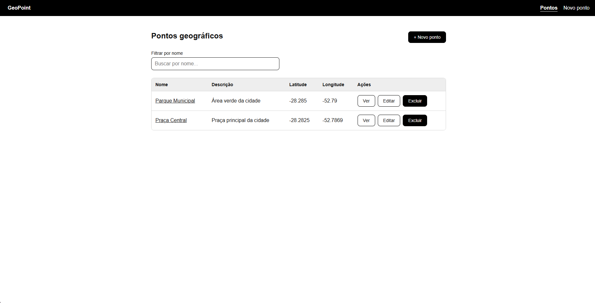
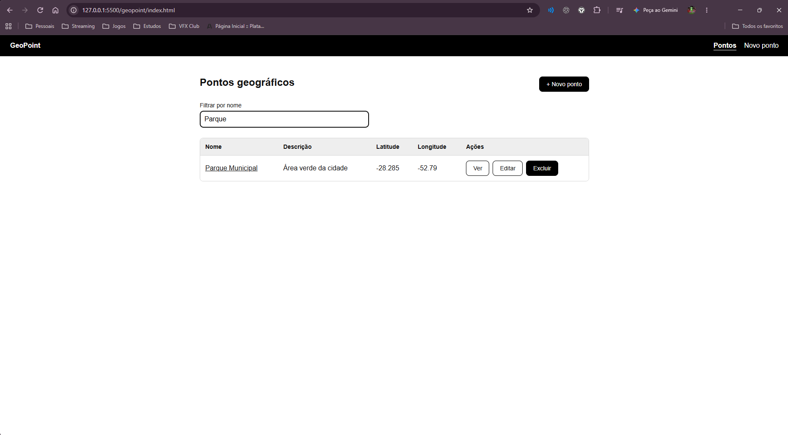
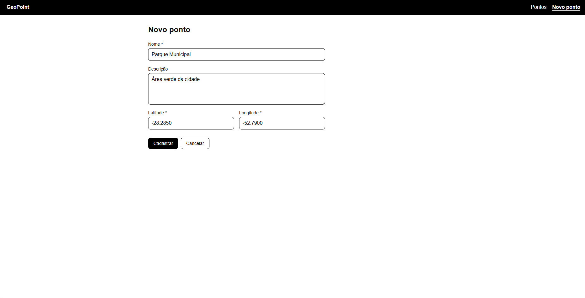
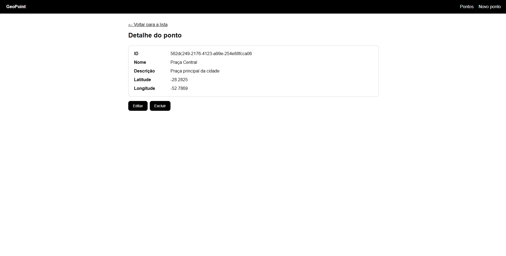
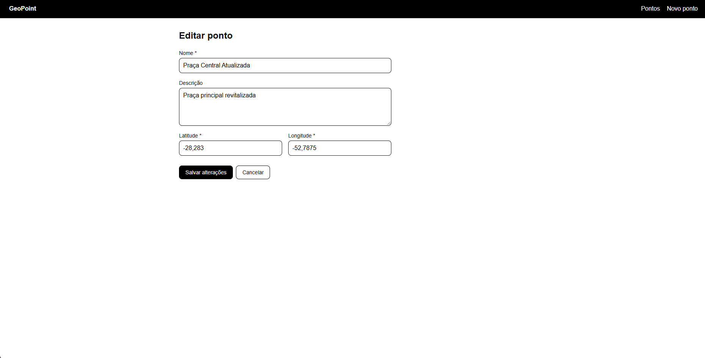

# Trabalho G2 — CRUD de Pontos Geográficos

**Disciplina:** Desenvolvimento Frontend — ATITUS

## Integrantes

- Thiago Corrêa Medeiros
- Vitor Gomide

## Objetivo

O GeoPoint é uma aplicação para cadastrar, listar, filtrar, consultar, editar e excluir pontos geográficos, utilizando a GeoPoint API. A interface segue como referência o protótipo Atitus WhiteLabel disponibilizado no Figma.

## Tecnologias utilizadas

- HTML
- CSS
- JavaScript puro
- Fetch API para comunicação com o backend

O projeto segue a estrutura dos exemplos da Aula 11 e não necessita de instalação de dependências no frontend.

## Divisão das atividades

- **Thiago Corrêa Medeiros:** montagem e desenvolvimento do frontend, organização das telas, integração com a API, execução dos testes e preparação dos prints.
- **Vitor Gomide:** revisão do código JavaScript, conferência das chamadas à API e repetição dos testes de cadastro, consulta, edição e exclusão (atividades previstas para a revisão final).

## Como rodar

1. Inicie o PostgreSQL com o banco `geo_point` e a tabela `points` configurados.
2. Abra o projeto separado `geopoint-backend` no IntelliJ IDEA, configure a conexão com o banco e execute `GeopointApplication`.
3. Confira a URL base da API no arquivo `js/api.js`. Para execução local, utilize `http://localhost:8080`.
4. Abra a pasta do frontend que contém o arquivo `index.html` no Visual Studio Code.
5. Clique com o botão direito em `index.html` e selecione **Open with Live Server**.
6. A API deve estar em execução e permitir requisições da origem do frontend (CORS). Na configuração local, utilize a porta 5500 do Live Server.

## API

URL base utilizada nos testes locais: `http://localhost:8080`.

| Método | Endpoint | Operação |
|---|---|---|
| GET | `/api/points` | Listar |
| GET | `/api/points/{id}` | Detalhar |
| POST | `/api/points` | Cadastrar |
| PUT | `/api/points/{id}` | Editar |
| DELETE | `/api/points/{id}` | Excluir |

## Páginas

- `index.html`: listagem, filtro por nome e exclusão.
- `formulario.html`: cadastro.
- `ponto.html?id=...`: detalhamento e exclusão.
- `formulario.html?id=...`: edição, utilizando o mesmo formulário do cadastro.

## Prints das telas

Capturas realizadas durante os testes do frontend integrado à GeoPoint API local.

### Listagem

### Filtro

### Cadastro

### Detalhe

### Edição

## Repositório do backend

A GeoPoint API utilizada neste projeto está disponível em:

https://github.com/thxw7/geopoint-backend

As instruções para configuração do banco de dados e execução
da API estão disponíveis no README do backend.